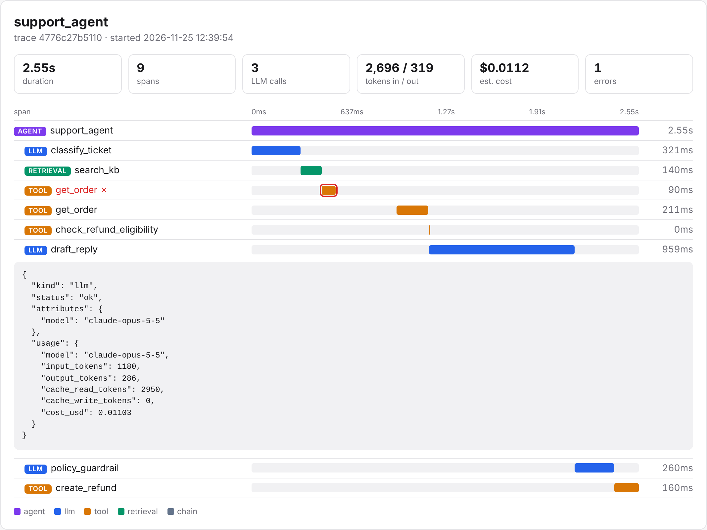

<div align="center">

# agentledger

**Lightweight tracing, token & cost accounting for LLM agents.**
See every model call, tool call and retry as a timed tree, with cost rolled up per step. Export to JSONL or a self-contained HTML timeline.

[](https://github.com/roomeesyncss/agentledger/actions/workflows/ci.yml)


</div>

---

<p align="center"></p>

The same run in the terminal:

```text
support_agent [agent]                  2.55s  $0.0112
├─ classify_ticket [llm]               321ms     612→24    tok  $0.0001
├─ search_kb [retrieval]               140ms
├─ get_order [tool]                     90ms  ✗ RateLimitError: 429 Too Many Requests (retry-after: 0.4s)
├─ get_order [tool]                    211ms
├─ check_refund_eligibility [tool]       0ms
├─ draft_reply [llm]                   959ms    1180→286   tok  $0.0110
├─ policy_guardrail [llm]              260ms     904→9     tok  $0.0001
└─ create_refund [tool]                160ms
── 9 spans · 2.55s · 2,696 in / 319 out tokens · $0.0112 · 1 error(s)
```

Here you can see at a glance that the order API rate-limited the first call, and that almost all of the cost is the one Opus call that writes the customer reply.

## Why

When an agent is slow, expensive or wrong, you need to know **which step** caused it. Full observability platforms are heavy to adopt; `print` debugging doesn't scale. agentledger is a small, zero-dependency library you can drop into any agent loop in minutes.

## Features

- **Nested spans** via `contextvars`. Parent/child links survive `await` and `asyncio.gather`.
- **`@trace` decorator** for sync and async functions, capturing args and return values (bounded, JSON-safe).
- **Token & cost accounting.** `span.record_response(response)` reads Anthropic-style usage, including cache reads and writes, and prices it. The pricing table is overridable.
- **Cost roll-up.** Each node in the tree shows the cost of its whole subtree.
- **Exporters.** JSONL (append-only, crash-safe), console tree, in-memory. A failing exporter never breaks your agent.
- **HTML timeline.** A single self-contained file (no JS, no CDN) with a waterfall per trace and expandable span details.
- **CLI.** `view`, `stats`, `html`.

## Install

```bash
pip install "git+https://github.com/roomeesyncss/agentledger"
```

## Quickstart

```python
from agentledger import ConsoleExporter, JSONLExporter, Tracer

tracer = Tracer([JSONLExporter("traces/run.jsonl"), ConsoleExporter()])


@tracer.trace(kind="tool")
def search_docs(query: str) -> list[str]: ...


with tracer.span("support_agent", kind="agent", input=question) as agent:
    docs = search_docs(question)
    with tracer.span("answer", kind="llm") as call:
        response = client.messages.create(...)
        call.record_response(response)  # tokens + cost
    agent.event("guardrail_passed")
```

Try it without an API key. [`examples/support_agent.py`](examples/support_agent.py) simulates a support agent handling a refund ticket: ticket classification, knowledge-base search, a rate-limited order API with backoff, a refund policy check and a guardrail on the reply.

```bash
python examples/support_agent.py
agentledger view  traces/support.jsonl
agentledger stats traces/support.jsonl
agentledger html  traces/support.jsonl -o traces/support.html
```

### With Claude

[`examples/claude_tool_agent.py`](examples/claude_tool_agent.py) is a complete tool-using agent (document search + safe calculator) where every model turn and tool call is a span:

```bash
pip install "agentledger[claude] @ git+https://github.com/roomeesyncss/agentledger"
export ANTHROPIC_API_KEY=...
python examples/claude_tool_agent.py "What is 17% of Q3 revenue, and how does Q3 compare to Q2?"
agentledger html traces/claude.jsonl
```

## Pricing

Default prices (USD per million tokens) cover current Claude models. Unknown models still record tokens, just without cost. Override or add your own:

```python
from agentledger import Pricing, Tracer

tracer = Tracer(pricing={"my-finetune": Pricing(input=1.0, output=3.0)})
```

Model names match exactly first, then by longest prefix.

## Development

```bash
pip install -e ".[dev]"
pytest && ruff check . && ruff format --check .
```

## Roadmap

- [ ] OpenTelemetry (OTLP) exporter
- [ ] Sampling for high-volume production traffic
- [ ] Trace diffing between two runs of the same agent

## Author

**Rooma Siddiqui**, AI Engineer (RAG pipelines, AI agents, backend & automation)
GitHub [@roomeesyncss](https://github.com/roomeesyncss)

## License

[MIT](LICENSE) © 2026 Rooma Siddiqui
